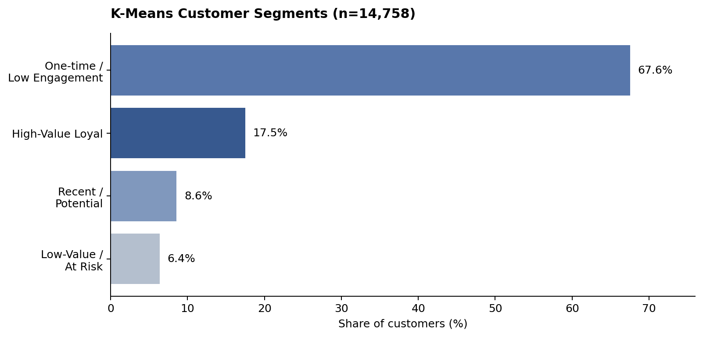
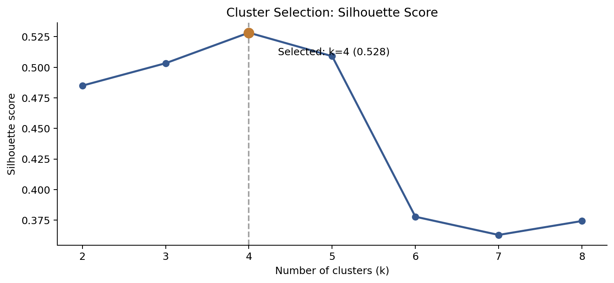
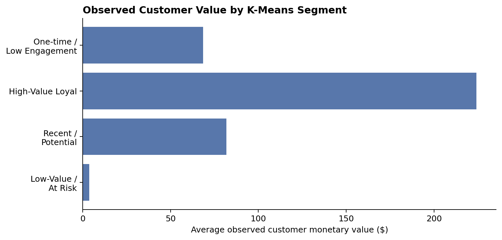

# E-Commerce Sales & Customer Analytics

**AIBC 2026 | End-to-End Business Analytics & Customer Segmentation**

**Python · Pandas · Exploratory Data Analysis · RFM · K-Means · Scikit-learn · Business Analytics**

## Project overview

This project analyzes historical transactions, product activity, and website traffic for an online e-commerce store (2016–2018). The objective is to understand sales performance and shopping behavior, identify conversion and retention opportunities, and translate customer segmentation into practical business recommendations.

**My role:** Led the project's technical analysis, including data processing, feature engineering, and customer segmentation using Python and Jupyter Notebook. Coordinated team contributions to data validation, quality checks, and result interpretation, while helping teammates understand the analytical methods. Collaborated with the team to develop and present the final findings.

> **Scope:** An observational, historical analysis. The recommendations are hypotheses for future testing, not proven causal impacts or implemented business improvements.

## Business snapshot

| Metric | Result |
|:--|--:|
| Total orders | **21,358** |
| Valid sales orders | **20,948** |
| Net revenue | **$1,369,270** |
| Average order value | **$65.37** |
| Customers with valid orders | **14,758** |
| Repeat customer rate | **21.32%** |
| Session-to-order conversion | **0.81%** |
| Refund amount rate | **13.33%** |

*Source: historical KPI summary in `results/kpi_summary.csv`; reported values use the project's original metric definitions.*

## Questions investigated

- How did sales and website traffic move over time, and how were sessions associated with orders?
- Which product types performed well over time?
- Where were the major purchase-funnel drop-offs and customer-retention opportunities?
- Which customer groups could benefit from differentiated engagement strategies?

The original assignment also asked whether discounts promote sales. The available final presentation does not establish a causal discount effect, so no such claim is made here.

## Workflow & methods

1. **Data preparation:** inspected and integrated customers, orders, order items, products, SKUs, website traffic, and transactions.
2. **KPI & exploratory analysis:** summarized order validity, revenue, refunds, product performance, site traffic, conversion, and repeat purchase behavior.
3. **Customer features:** generated Recency, Frequency, and Monetary (RFM) measures; used log transformation and feature scaling for clustering.
4. **Unsupervised learning:** compared K-Means models for k=2–8 using inertia and silhouette scores; selected **k=4** (silhouette score **0.528**).
5. **Business interpretation:** profiled the four groups using their purchasing history and observed monetary value.

## Key findings

### 1. Customer segmentation



| K-Means segment | Customers | Share | Avg. observed monetary value |
|:--|--:|--:|--:|
| One-time / Low Engagement | 9,970 | 67.56% | $68.54 |
| High-Value Loyal | 2,583 | 17.50% | $224.21 |
| Recent / Potential | 1,265 | 8.57% | $81.74 |
| Low-Value / At Risk | 940 | 6.37% | $3.63 |

*Segments are descriptive labels assigned after clustering, not externally validated customer types. “Observed value” summarizes historical customer spending, not predicted future CLV.*

### 2. Model selection



The four-cluster solution had the highest silhouette score among the tested options, although clustering quality does not by itself demonstrate business impact.

### 3. Value differentiation



The High-Value Loyal cluster showed substantially greater historical monetary value per customer. Meanwhile, most customers fell into the One-time / Low Engagement cluster, indicating a potential opportunity to investigate second-purchase behavior.

### 4. Conversion & retention

The presentation reported a **0.770 correlation** between daily sessions and valid orders; this association should not be interpreted as traffic causing orders. The **0.81% session-to-order conversion rate** and **21.32% repeat customer rate** point to possible areas for further investigation.

## Recommendations to test

- **Retention:** pilot post-purchase follow-ups, personalization, and second-order incentives for low-engagement customers.
- **High-value customers:** test differentiated loyalty experiences and targeted engagement.
- **Conversion:** review product-detail pages, cart friction, and checkout drop-off; evaluate changes through controlled experiments.
- **Refunds:** investigate product-level refund patterns before recommending operational changes.

These are proposed actions; the dataset does not show measured uplift from implementation.

## Repository guide

```text
ecommerce-sales-customer-analytics/
├── README.md
├── notebooks/
│   ├── 01_data_understanding.ipynb
│   └── 02_ecommerce_analysis_and_segmentation.ipynb
├── results/                     # Aggregated analysis tables
├── figures/                     # Charts generated from results tables
├── presentation/
│   └── AIBC_2026_team_presentation.pdf
├── data/raw/README.md           # Expected input datasets (not included)
├── requirements.txt
└── .gitignore
```

## Reproducing the analysis

1. Install dependencies: `pip install -r requirements.txt`.
2. If you have permission to use the source data, place these seven CSVs in `data/raw/`: `customers.csv`, `orders.csv`, `orders_items.csv`, `products.csv`, `products_skus.csv`, `traffic.csv`, `transactions.csv`.
3. From the `notebooks/` directory, run `01_data_understanding.ipynb`, followed by `02_ecommerce_analysis_and_segmentation.ipynb`.

**Data availability:** The original customer-level data is not included while redistribution rights and privacy constraints are unconfirmed. The included notebooks contain previously saved outputs; an independent clean rerun has **not** been verified without the original source data. Some original code comments are in Chinese, reflecting the original working notebooks.

## Presentation & credit

The [AIBC 2026 team presentation](presentation/AIBC_2026_team_presentation.pdf) was created collaboratively after I walked the team through the underlying technical analysis. Team members are credited on its title slide. All technical analysis and implementation described above were independently completed by me.

## Limitations

- Results describe historical activity and should not be assumed to generalize to current shoppers.
- Refunds and other metrics depend on the cleaning and business-rule definitions in the notebooks.
- K-Means groups are exploratory, not evidence of improved retention or revenue.
- A separate rules-based RFM summary exists in `results/rfm_segment_summary.csv`. Its segment labels should **not** be equated with the K-Means labels, as the methods produce different group sizes.
- The final presentation reports findings, but does not establish a controlled causal effect of discounts or business interventions.
